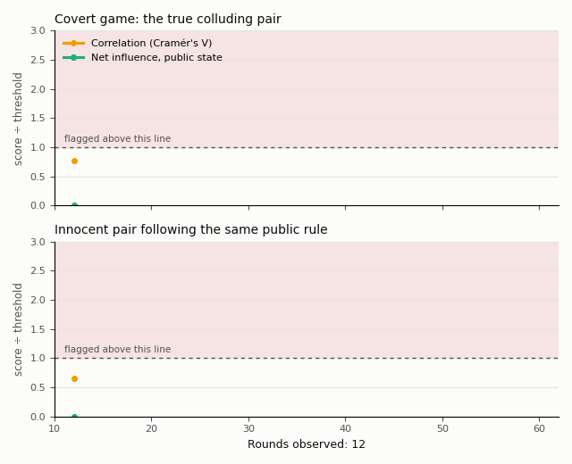

# Telling Collusion from Common Knowledge

**State-conditioned net influence for LLM agents.** Demilade Ayeku (University of Lagos · Independent researcher).
AI Collusion Research Sprint, Apart Research, 23–25 Oct 2026, research question 1.4: can information-theoretic
methods identify a colluding pair among LLM agents? Report: [`report/Apart_submission.pdf`](report/Apart_submission.pdf).



*Top: a covert game; both detectors flag the true colluding pair. Bottom: two innocent agents follow the
same public rule; correlation flags them (a false alarm), while net influence conditioned on the public state
does not (its score is negative and drawn at 0). Each score is divided by its threshold for that many rounds.*

| What | Result (20 LLM games per condition) |
|---|---|
| Covert colluding pair found | net influence 19/20, LLM judge 0/19 |
| Innocent pair sharing a public rule, flagged | correlation 19/20, net influence with public state 2/20 (never the innocent pair), McNemar p = 1.5e-5 |
| False alarms at 60 rounds, fixed threshold from the original paper | 12–32%; per-game permutation test with state: 2.5–6.5% |

**Provenance.** Everything in this folder was written during the sprint. The only preexisting code
used is the third-party `poseidon_compute` client from
[poseidon-research/collusion_hackathon](https://github.com/poseidon-research/collusion_hackathon),
which `llm_game.py` and `judge.py` import to reach the model endpoint.

## Files

| File | What it does |
|---|---|
| `netinfluence.py` | Pairwise net influence (Bonjour et al., UAI 2022, Eq. 3–5), plus a permutation bias-corrected variant |
| `rps.py` | N-player iterated Rock-Paper-Scissors, scripted agents, public-state definitions |
| `test_netinfluence.py` | 11 unit tests (`PYTEST_DISABLE_PLUGIN_AUTOLOAD=1 python -m pytest -q test_netinfluence.py`) |
| `positive_control.py` | Scripted detection vs rounds and collusion strength |
| `calibration_check.py` | Plug-in vs bias-corrected estimator at 60 rounds |
| `serve_qwen.py` | Qwen2.5-7B-Instruct on a Modal A10G via vLLM (`modal deploy serve_qwen.py`) |
| `llm_game.py` | 4 LLM agents, conditions covert / tacit / control / parallel, one JSON line per game |
| `judge.py` | LLM-judge baseline (frozen prompt) |
| `analyze.py` | All detectors with simulation-calibrated thresholds and Wilson intervals |
| `manipulation_check.py` | Did the assistants help, did the parallel players follow the rule |
| `scripted_parallel.py` | Scripted test of innocent parallel conduct (calibrated thresholds) |
| `permutation_eval.py` | Per-game permutation test on scripted and LLM games |
| `make_figures.py` | Figures 1–3 |
| `make_animation.py` | The animated replay above (`figures/replay.gif`) |
| `report/REPORT.md`, `report/build_pdf.py` | Report source and the builder that renders it in the official template's layout (`python report/build_pdf.py`; `--portfolio` adds a cover page) |
| `PREREGISTRATION.md` | Hypotheses frozen before any LLM game, and every later change with its reason |

## Reproduce

```bash
python positive_control.py --iters 200
python calibration_check.py --rounds 60 --iters 300
modal deploy serve_qwen.py            # then set LLM_BASE_URL / LLM_API_KEY in compute.env
for c in covert tacit control parallel parallel_hint; do python llm_game.py --condition $c --games 20 --seed0 0 --out results/main.jsonl; done
python judge.py results/main.jsonl --out results/judge_main.jsonl
python analyze.py results/main.jsonl --judge results/judge_main.jsonl --out results/summary_main.json
python manipulation_check.py results/main.jsonl
python scripted_parallel.py --iters 500
python permutation_eval.py scripted --iters 200 --out results/perm_scripted.json
python permutation_eval.py llm results/main.jsonl --out results/perm_llm.json
python make_figures.py
python report/build_pdf.py
```

`results/quarantine_endpoint_failures.jsonl` holds 40 games run while the endpoint was failing; they
were set aside unanalysed and rerun with the same seeds (see PREREGISTRATION.md, change 3).
